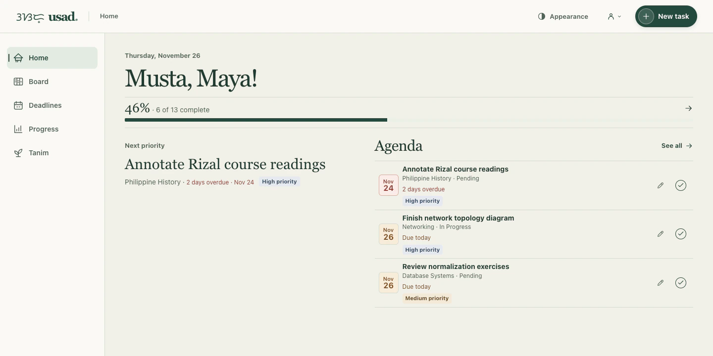
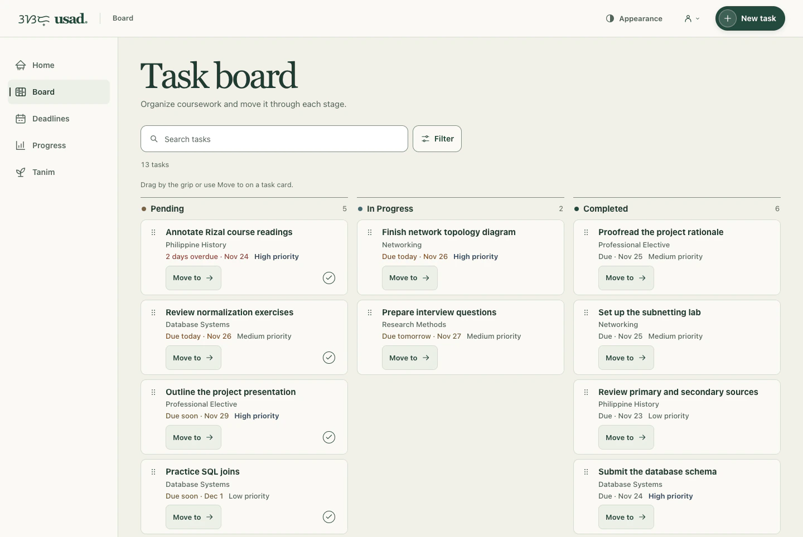
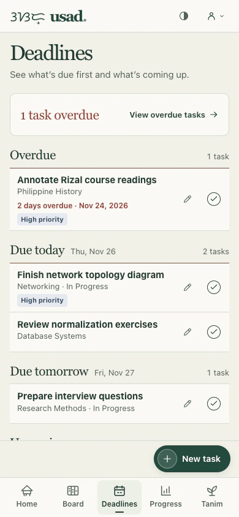
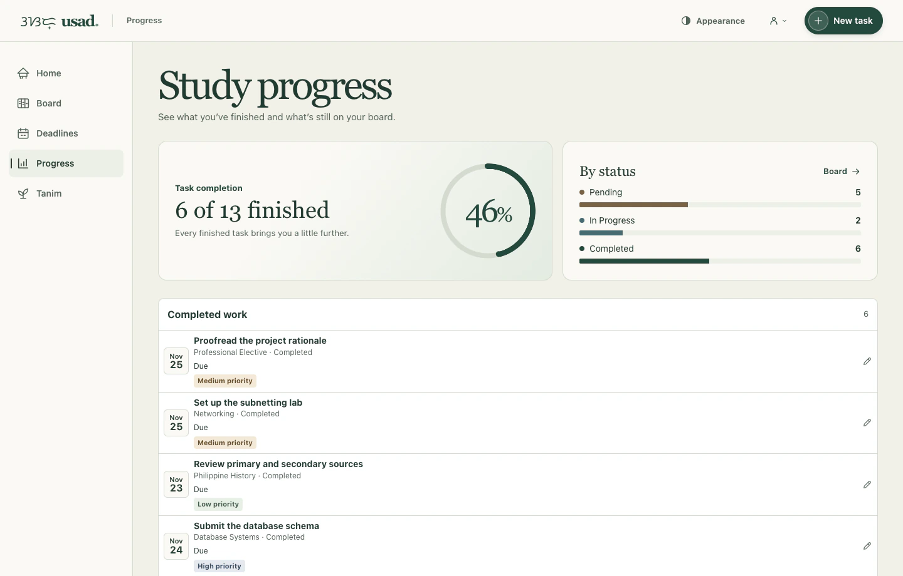
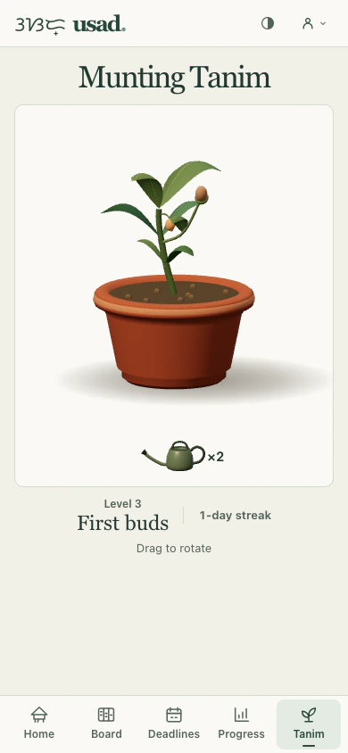
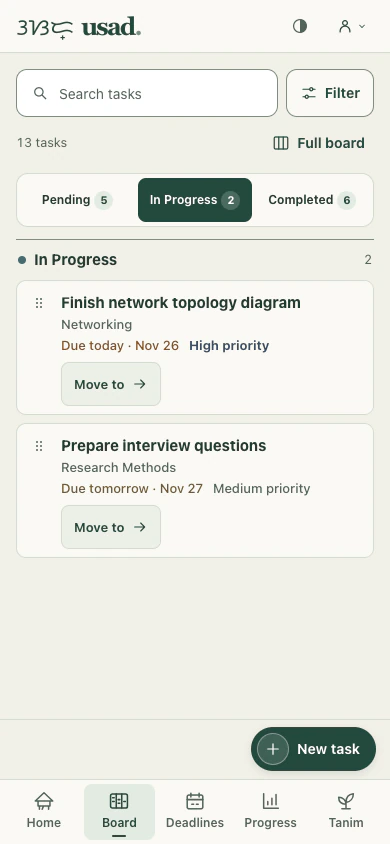

# USAD
### The Art of Making Progress

**ᜂᜐᜇ᜔ · Munting hakbang. Tunay na pag-usad.**

*Small steps. Real progress.*

USAD is a Filipino-inspired productivity app for students. Keep assignments, deadlines, and academic progress in one workspace, then water a small interactive garden with drops earned by finishing tasks.

**[Open the live application](https://ccadaverr-usad-blue.vercel.app)**

## Application screenshots



| Board | Deadlines |
| --- | --- |
| [](docs/screenshots/board.webp) | [](docs/screenshots/deadlines.webp) |
| **Progress** | **Munting Tanim** |
| [](docs/screenshots/progress.webp) | [](docs/screenshots/munting-tanim.webp) |

[](docs/screenshots/mobile.webp)

All screenshots use a disposable local guest workspace with fictional coursework.

## About USAD

USAD brings a Filipino perspective to student task management. Baybayin appears in the wordmark. Munting Tanim gives completed work a visible effect as students earn water and care for a plant over time.

- **Home** highlights the next priority and upcoming work in a daily agenda.
- **Board** lets students create and edit assignments and move them through Pending, In Progress, and Completed using drag-and-drop or the **Move to** picker.
- **Deadlines and Progress** group open assignments by urgency and summarize completion across the workspace.
- **Munting Tanim** turns first completions into water drops. Confirmed watering grows the specimen, and daily completion streaks appear as fruit.
- **Guest workspace** keeps tasks and garden state on the server, scoped to a signed browser session. Appearance preferences stay in the browser.
- **Appearance** offers Forest, Blue Hour, and Warm Clay in light, dark, or system mode. The interface adapts to desktop and mobile.

## Technology

| Area | Tools |
| --- | --- |
| Frontend | Angular 20, TypeScript, Angular CDK, NgRx SignalStore, Tailwind CSS 4, daisyUI 5 |
| Interactive graphics | Three.js with an SVG fallback |
| Backend | Node.js, JSON Server, persistent JSON files scoped to each guest |
| Hosting | Vercel frontend, Railway API and persistent volume |

## Getting started

Use Node.js 22 and npm. Clone the repository and install its locked dependencies.

```bash
git clone https://github.com/ccadaverr/usad.git
cd usad
npm ci
```

Start the API in one terminal and Angular in a second.

```bash
npm run api   # terminal 1 · 127.0.0.1:3000
npm start     # terminal 2 · localhost:4200
```

Open [localhost:4200](http://localhost:4200) and choose **Continue as Guest**. The Angular development proxy forwards `/api` to the loopback API and strips the prefix. Local guest files are stored under `data/guests/` by default. Set `USAD_GUEST_DIR` to a disposable directory when collecting screenshots or doing manual mutation tests. A hosted preview uses the checked-in production API rewrite unless its deployment configuration explicitly replaces it.

## Architecture

The Angular views share a SignalStore for tasks and Board state. The browser calls the same-origin `/api` routes. The Node API checks the signed guest cookie and owns each workspace’s task and garden state. Task and garden changes are saved together by atomically replacing that guest’s JSON file.

[Implementation overview](docs/IMPLEMENTATION.md) · [Guest API and garden contract](docs/GUEST-EXPERIENCE.md) · [Deployment and release record](docs/usad-coordinated-release.md) · [Historical notes](docs/archive/README.md)

## Testing

Install Chrome to run the Angular suite. If it is outside the default search path, point `CHROME_BIN` to the executable.

```bash
npm run test:ci
npm run test:api
npm run build
```

The API test suite uses temporary local workspaces. [GitHub Actions workflow](.github/workflows/ci.yml)

## About the developer

Hi, I’m **Jaztin**, a third-year Information Technology student at **Dr. Yanga's Colleges, Inc.**

USAD started as an academic requirement for our Professional Elective subject. I kept working on it beyond the course requirement because I wanted to make something other students could genuinely use. Building USAD gave me a way to explore how managing assignments, seeing progress, and caring for Munting Tanim could make everyday academic work feel more meaningful.

The application is deployed and usable. It’s an independent student project that I improve from time to time as I keep learning.

## Credits and license

USAD is adapted from [TaskFlow by tiennd03](https://github.com/tiennd03/taskflow) and retains the [MIT license](LICENSE). The Baybayin wordmark uses [Noto Sans Tagalog](https://github.com/notofonts/tagalog) under the [SIL Open Font License](public/fonts/OFL.txt).
